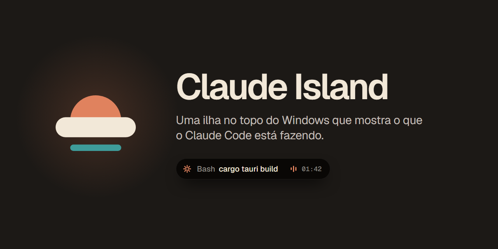
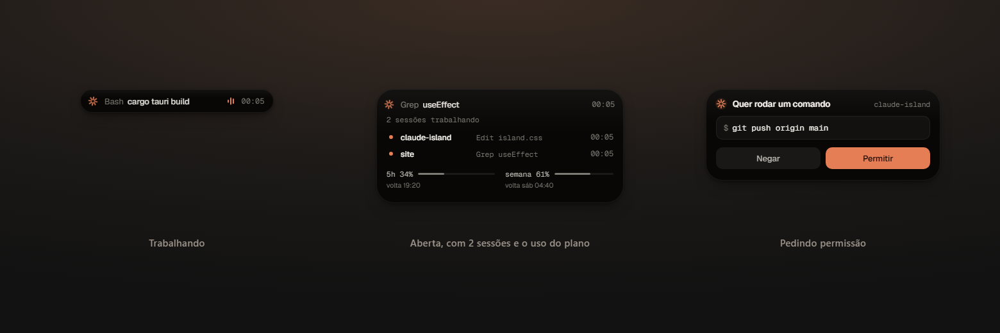

<p align="center"></p>

# Claude Island

Uma pílula sempre no topo do Windows que mostra o que o Claude Code está fazendo: a ferramenta em uso, há quanto tempo, quando ele terminou e quando precisa de você. Pedidos de permissão aparecem na própria ilha, com os botões Permitir e Negar.

<p align="center"></p>

## O que ela faz

- Enquanto o Claude trabalha, a pílula mostra a ferramenta e o argumento (`Bash cargo build`, `Edit island.css`) e um relógio.
- Com o mouse parado meio segundo em cima, ou com um clique, ela abre e mostra os últimos passos. Com várias sessões ao mesmo tempo, mostra uma linha por projeto.
- Pedidos de permissão chegam na ilha. Se ninguém clicar em 30 s, o pedido volta para o terminal como sempre.
- Quando termina, aparece um ✓ com o tempo total. Quando ele está esperando você, aparece um aviso.
- O uso do plano (janela de 5 horas e semana, com o horário em que cada uma zera) aparece para quem tem Pro, Max ou Ultra.
- Dá para arrastar e soltar em qualquer canto ou no meio de uma lateral, e ela encaixa. Nas laterais ela fica em pé.
- Ela some em chamadas (Meet, Teams, Zoom, WhatsApp e outros que você marcar), em jogo ou vídeo em tela cheia e no horário de não perturbe.
- A janela é transparente e só a pílula recebe o mouse, então o que está atrás continua clicável.

## Instalar

Precisa de Windows 10 ou 11, [Claude Code](https://code.claude.com/docs) e [Node.js](https://nodejs.org) no PATH.

1. Baixe o `Claude.Island_x.y.z_x64-setup.exe` em [Releases](../../releases/latest) e rode. Como o instalador não tem assinatura digital, o Windows pode mostrar o aviso do SmartScreen: clique em "Mais informações" e depois em "Executar assim mesmo".
2. O instalador liga os hooks no `~/.claude/settings.json` (faz backup antes) e, se você não tiver nenhuma, a statusline que manda o uso do plano.
3. Reinicie as sessões do Claude Code que já estavam abertas.

Para a ilha abrir junto com o Windows, baixe o [`autostart.ps1`](autostart.ps1) deste repositório e rode:

```powershell
powershell -File autostart.ps1          # cria a tarefa "Claude Island" no Agendador
powershell -File autostart.ps1 -Remove  # remove
```

Desinstalar pelo Windows tira os hooks e a statusline que o instalador colocou.

## Configurar

Clique no ícone da ilha na bandeja. A janela tem quatro partes, e tudo vale na hora:

- "Esconder a ilha quando" tem um interruptor para cada app de chamada, para o Discord, para tela cheia e para uma lista extra de `.exe`.
- "Não perturbe" recebe o horário e os dias da semana.
- "Aparência" muda a opacidade, o tamanho (de 80% a 140%) e liga o modo compacto.
- "Uso do plano" liga ou desliga os números na ilha e mostra os valores atuais.

As escolhas ficam em `%APPDATA%\dev.local.claude-island\config.json`. "Voltar ao topo", no menu do botão direito, põe a ilha de volta no topo central.

## Como funciona

```
Claude Code ──hook──▶ island-hook.js ──POST 127.0.0.1:47821──▶ app Tauri ──evento──▶ ilha (HTML/CSS/JS)
            ◀─────────────── decisão de permissão (Permitir/Negar) ◀───────────────
```

- `hook/island-hook.js` lê o evento do Claude Code no stdin e manda para a ilha. Se a ilha estiver fechada, sai em silêncio e o Claude Code segue normal.
- `hook/island-status.js` é a statusline: repassa `rate_limits` para a ilha e imprime uma linha curta no terminal.
- `src-tauri/` (Rust, Tauri 2) recebe os eventos, controla a janela transparente sempre no topo, decide quando ela pega o mouse e quando some.
- `ui/` é a ilha e a janela de configurações, sem bundler.

Quatro escolhas que não aparecem só lendo o código:

- O servidor escuta apenas em `127.0.0.1`, exige `Content-Type: application/json` e recusa pedidos com cabeçalho `Origin`. Com isso, um site aberto no navegador não consegue mostrar pedidos de permissão falsos na ilha.
- O uso do microfone vem das sessões de captura do WASAPI, com o `.exe` de cada uma. O registro `CapabilityAccessManager\ConsentStore`, que muitos exemplos usam, parou de ser atualizado no Windows 11 recente.
- O instalador copia os scripts para `~/.claude/hooks/` e os hooks chamam essa cópia, então mudar a pasta do projeto de lugar não quebra nada.
- Comandos rodados de dentro do app Claude para Windows (pacote MSIX) têm o `AppData` redirecionado, e a ilha instalada por lá não aparece no logon. Instale com dois cliques no setup ou por uma tarefa do Agendador.

Diagnóstico: `%TEMP%\claude-island.log`, zerado a cada abertura.

## Compilar

Precisa de [Rust](https://rustup.rs) e do [Tauri CLI](https://v2.tauri.app/reference/cli/) (`cargo install tauri-cli --version "^2"`).

```powershell
cd src-tauri
cargo tauri dev     # desenvolvimento
cargo tauri build   # instalador em src-tauri/target/release/bundle/nsis
```

Para testar sem o Claude Code, com a ilha aberta:

```powershell
node test/simulate.js
```

Para ligar ou desligar os hooks à mão:

```powershell
node install-hooks.js
node install-hooks.js --uninstall
```

## Estrutura

```
brand/          logo, banner e ícones
hook/           hook e statusline do Claude Code
src-tauri/      app em Rust (Tauri 2) e instalador NSIS
ui/             ilha e janela de configurações
test/           simuladores de sessão, permissão e tarefa agendada
preview/        protótipo visual dos estados
install-hooks.js
autostart.ps1
```

## Aviso

Projeto pessoal, sem ligação com a Anthropic. "Claude" e "Claude Code" são marcas da Anthropic.

## Licença

[MIT](LICENSE)
